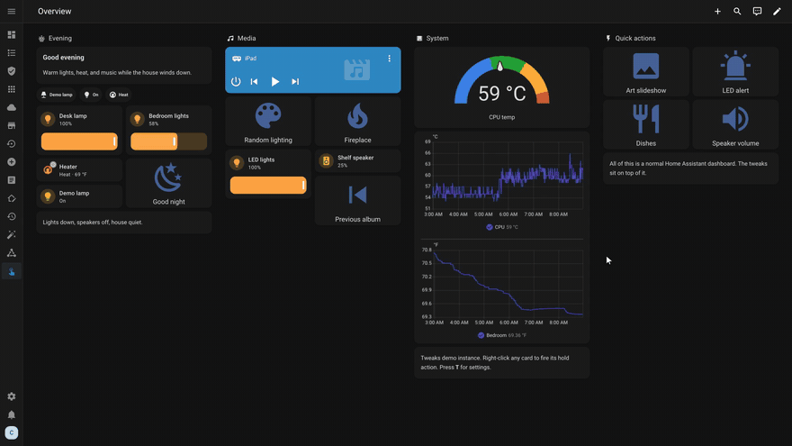
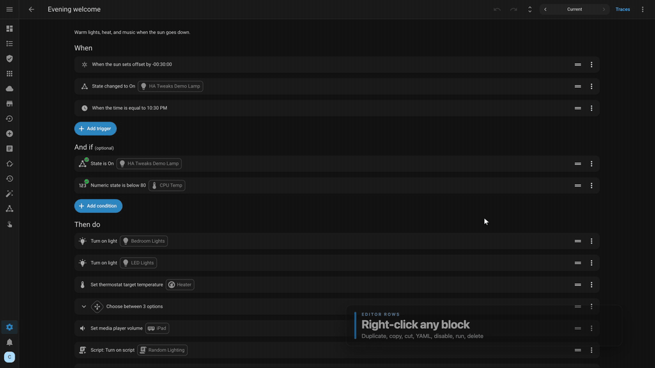
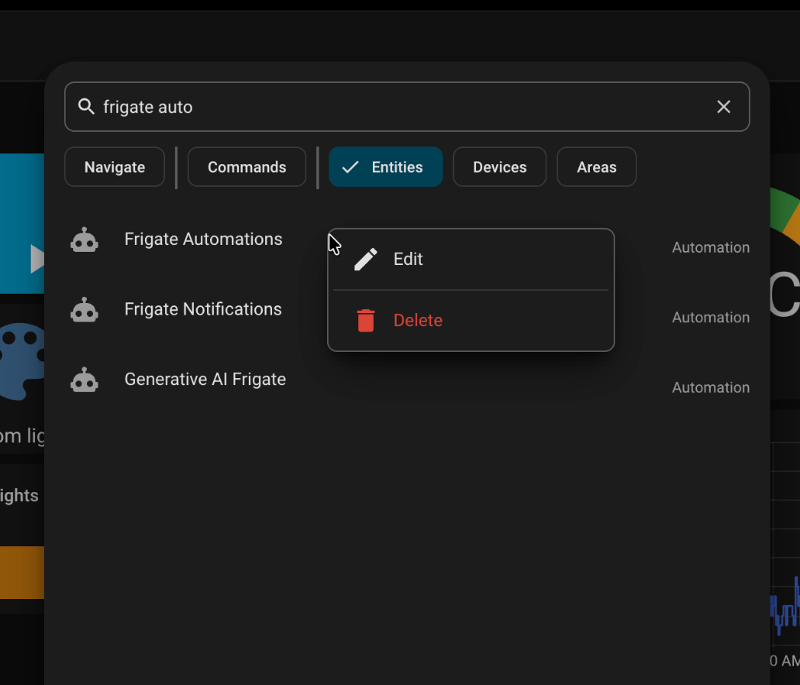
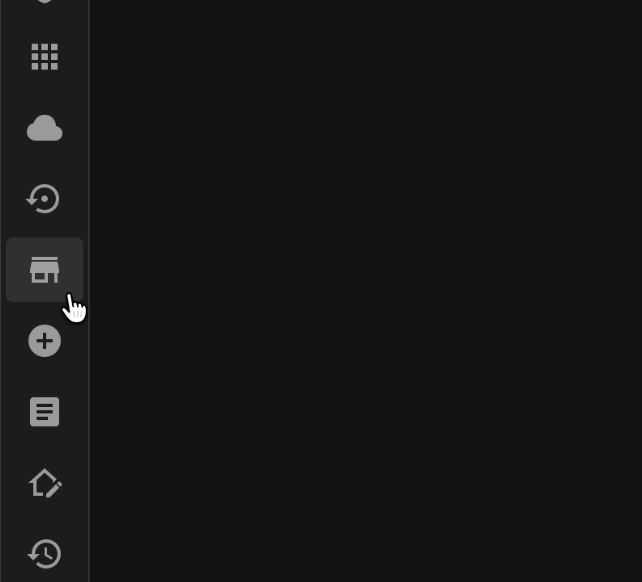
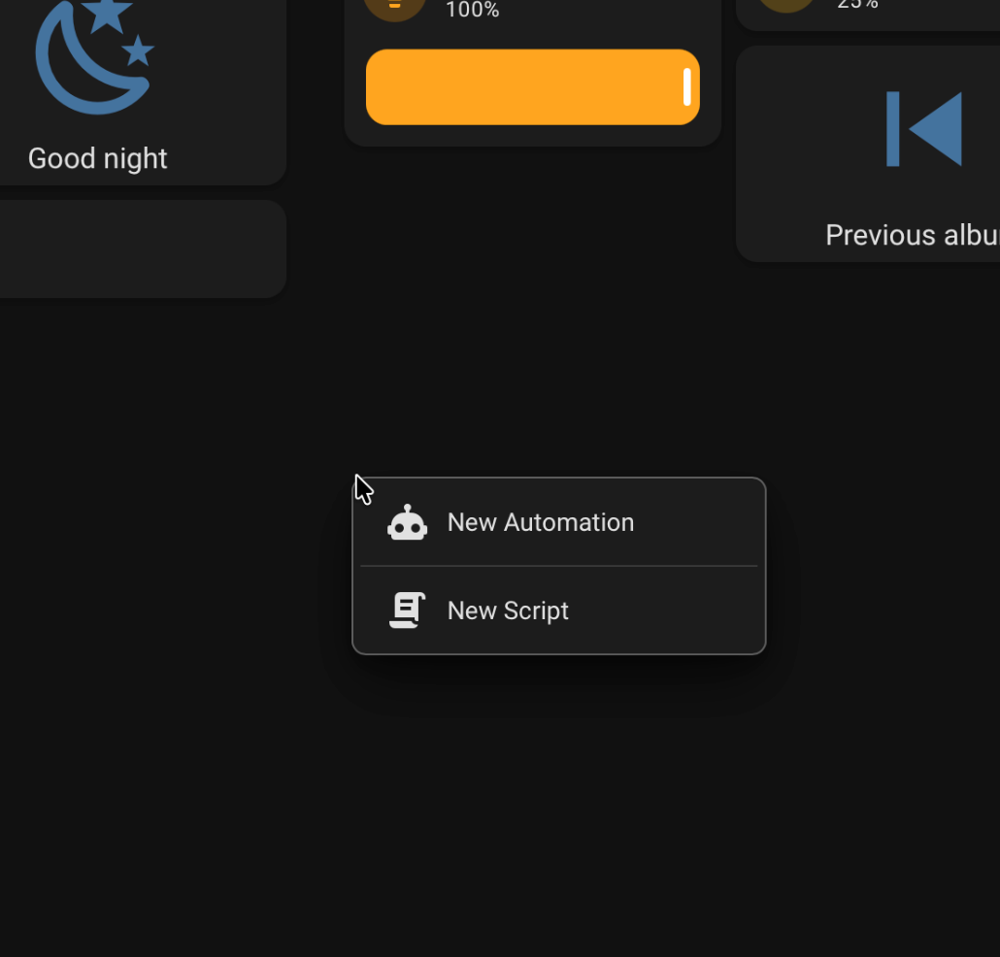

# <sup></sup> Home Assistant Tweaks

Small quality-of-life tweaks that make Home Assistant easier and more enjoyable to use. A growing collection of frontend improvements, new interactions, and little features that make a difference in everyday use.

This is a community project and anyone can submit a tweak. There are only a few so far, with many more to come. See [Contributing](CONTRIBUTING.md) to add yours.

Press **`T`** anywhere in Home Assistant to open settings. Every toggle applies right away. No YAML edits, no page reload, no server restart.



*[Watch the full tour video](assets/ha-tweaks-tour-v1.18.19.mp4) · [Documentation & Wiki](https://github.com/saihgupr/HomeAssistantTweaks/wiki/Home)*

---

## Highlights

### Recover earlier versions of automations and scripts
The Version Control app snapshots your config files to Git each time they change. With it installed, the automation and script editors gain version navigation: step back through earlier versions of the one you are editing, preview any version in the editor or as YAML, and bring it back by saving. Requires the Home Assistant Version Control app.


### Collapsed editor by default
Instead of one long scrolling page, automations open with all blocks collapsed. A toolbar button collapses or expands everything at once for the whole editor.


### Inline title renaming
Click the title in the editor header and rename it there. Press Enter or click outside to save.


### Instant card hold actions
Right-click any dashboard card, badge, or tile to trigger its hold action at once, without the usual press-and-hold wait. Left-clicks work as before.


### Drag-to-reorder sidebar
Drag sidebar items into the order you want. The order saves to Home Assistant's own sidebar storage, so it syncs per user across desktop and mobile.


### Mushroom chips that wait (`for:`)
Give a chip a `for:` duration and it stays hidden until the entity state has lasted that long. No template math or helper sensors needed.


### Context menus where you right-click
Right-click (or long-press in the Companion App) an automation or script to open Edit or Delete. Works on dashboards, in configuration tables, and in quick search.


### Context menu in quick search
Press `E` (or `Ctrl+K`) and right-click an automation or script result to edit or delete it without leaving the search. Dismissing the menu keeps the results open. It uses the same settings toggle as the dashboard and table menus.

### Copy, cut, or duplicate editor rows
Right-click any trigger, condition, or action row inside the editor to copy, cut, or duplicate it.



---

## New Additions

<table>
<tr>
<td width="75%" valign="top"><strong>Quick search context menu</strong><br><small>Right-click (or long-press) an automation or script in quick search (<code>E</code> / <code>Ctrl+K</code>) to Edit or Delete it without leaving the results. Dismissing the menu keeps the search open. It uses the same settings toggle as the dashboard and table menus.</small></td>
<td width="25%" valign="top"><a href="assets/search-right-click.png"></a></td>
</tr>
</table>

<table>
<tr>
<td width="75%" valign="top"><strong>Optional Marketplace sidebar item</strong><br><small>Adds a direct link to the Home Assistant Marketplace in the sidebar for admin users. No <code>panel_custom</code> configuration or restart needed. It can be reordered or hidden at any time.</small></td>
<td width="25%" valign="top"><a href="assets/marketplace-sidebar.png"></a></td>
</tr>
</table>

<table>
<tr>
<td width="75%" valign="top"><strong>Dashboard empty-space menu</strong><br><small>Right-click (or long-press) empty space on a dashboard to open a short menu with New Automation and New Script. Each item can be switched on or off in settings.</small></td>
<td width="25%" valign="top"><a href="assets/empty-space-menu.png"></a></td>
</tr>
</table>

---

## Installation

### Quick Start (Marketplace)

1. Open the repository directly in Home Assistant:

   [](https://my.home-assistant.io/redirect/hacs_repository/?owner=saihgupr&repository=HomeAssistantTweaks&category=plugin)

   Or add it by hand: in Home Assistant go to **Settings → Marketplace → Add from link** (on older versions: **Marketplace → Custom repositories**) with category **Plugin**, and enter:
   ```text
   https://github.com/saihgupr/HomeAssistantTweaks
   ```
2. Install **Home Assistant Tweaks**.
3. Add the loader to `configuration.yaml`. The Marketplace already registers `ha-tweaks.js` as a dashboard resource, so dashboards work without this step. The loader is what makes the tweaks run on Settings, Developer Tools, and other non-dashboard pages too:
   ```yaml
   frontend:
     extra_module_url:
       - /local/community/HomeAssistantTweaks/ha-tweaks-loader.js
   ```
   On a pre-2026.11 HACS install, keep using `/hacsfiles/HomeAssistantTweaks/ha-tweaks-loader.js`.
4. Restart Home Assistant once. Reload your browser page and press **`T`** to choose your tweaks.

<details>
<summary><b>Manual Installation</b></summary>

1. Download [`ha-tweaks.js`](ha-tweaks.js) and [`ha-tweaks-loader.js`](ha-tweaks-loader.js).
2. Place both files in your `<config>/www/` directory.
3. Add the loader reference to `configuration.yaml`:
   ```yaml
   frontend:
     extra_module_url:
       - /local/ha-tweaks-loader.js
   ```
4. Restart Home Assistant once and reload the page. Press **`T`** to open settings.

*Upgrading from v1.8.2 or earlier (formerly HA Mods): the script file was consolidated to `ha-tweaks.js`. Update your `extra_module_url` line to the loader path above; previously saved preferences transfer automatically.*

</details>

<details>
<summary><b>Updating & Verifying</b></summary>

### Updates
Update the plugin in Marketplace, then reload the page. The loader checks the asset ETag, so a normal reload usually picks up the new version without restarting Home Assistant.

If the console still shows the old version, the browser kept a cached copy. Hard-reload the page (`Ctrl+F5` or `Cmd+Shift+R`) or clear the site's cached data, then reload again. In the Companion App, force-close and reopen the app.

### Verification
Open your browser developer console (`F12` or `Cmd+Option+I`) and look for:
```text
[HA Tweaks v1.18.24] Initialized
```
Typing `HATweaks.version` in the console returns the active version string.

</details>

---

## How It Works & Safety

- **No dependencies, no network calls.** One small file. Nothing is sent anywhere.
- **Browser only.** It changes the pages you see. It never edits YAML files, automations, entities, or stored data.
- **Isolated tweaks.** Each tweak stands alone. If a Home Assistant update breaks one, that one stops and the rest keep working.
- **Opt in.** Fresh installs start with everything off. Turn on only what you want. Turn everything off to get stock Home Assistant back.
- **Sync per user.** Toggles are stored in Home Assistant user data with a local cache, so they follow you between desktop and the Companion App.

---

## Disable or Remove

- **To temporarily disable:** Press **`T`** and turn off individual switches (or toggle all off to return to stock).
- **To uninstall:** Remove the plugin from Marketplace, remove the `extra_module_url` line from `configuration.yaml`, and restart Home Assistant once.

---

## FAQ

**Does this work in the Home Assistant Companion App?**  
Yes. Right-clicks become long-presses, and sidebar items drag with touch and hold. On devices without a physical keyboard, run `HATweaks.openSettings()` in a console to open settings.

**Does this cause frontend lag or drain battery?**  
No. There is no polling. Menus and drags answer to events, and editor folding runs once when the editor opens.

**Why does an automation say "No UI ID"?**  
That automation is defined in YAML without an `id:`. Home Assistant needs an `id:` to open it in the visual editor, so add one to the YAML.

---

## Contributing

This is a community project. To submit a tweak, follow [CONTRIBUTING.md](CONTRIBUTING.md): fork the repository, add your tweak to `ha-tweaks.js`, verify with `node --check ha-tweaks.js`, and open a Pull Request targeting `develop`.

---

## Related Projects

- [Home Assistant Version Control](https://github.com/saihgupr/HomeAssistantVersionControl) - Automated snapshot history and restore engine for automations, scripts, and views (powers the version history tweak).
- [Home Assistant Time Machine](https://github.com/saihgupr/HomeAssistantTimeMachine) - Browse historical backups and restore individual files, views, and packages.

---

## Support & Feedback

If you encounter any issues, bugs, or have feature requests, please [open an issue on GitHub](https://github.com/saihgupr/HomeAssistantTweaks/issues).

Home Assistant Tweaks is open-source and free. If you find it useful, consider giving it a star on GitHub or making a donation to support development!

[](https://ko-fi.com/saihgupr)
