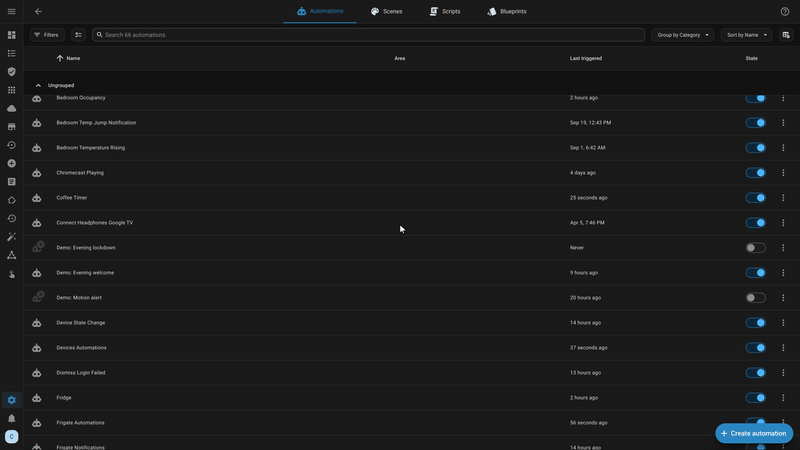
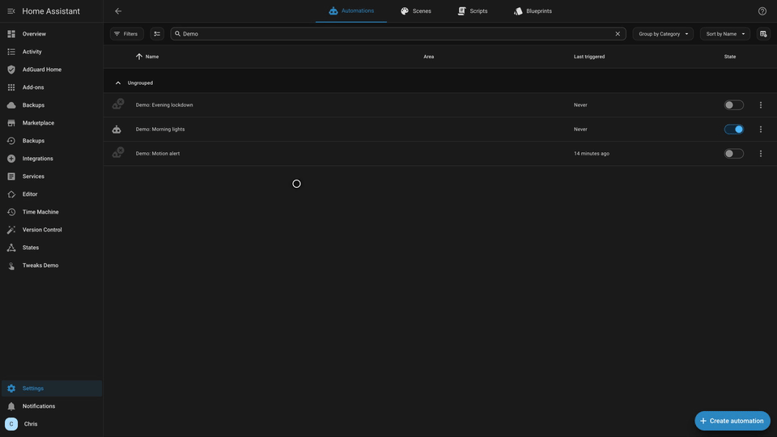
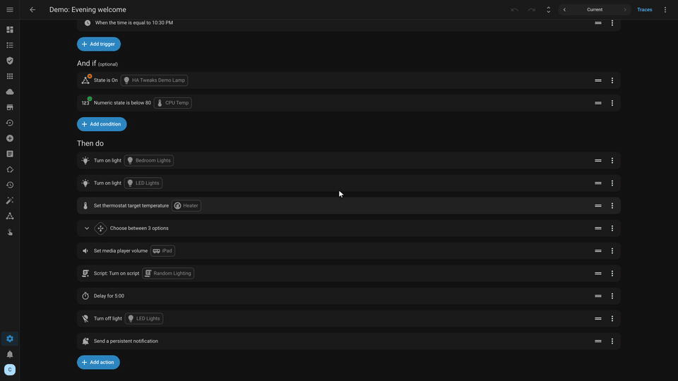
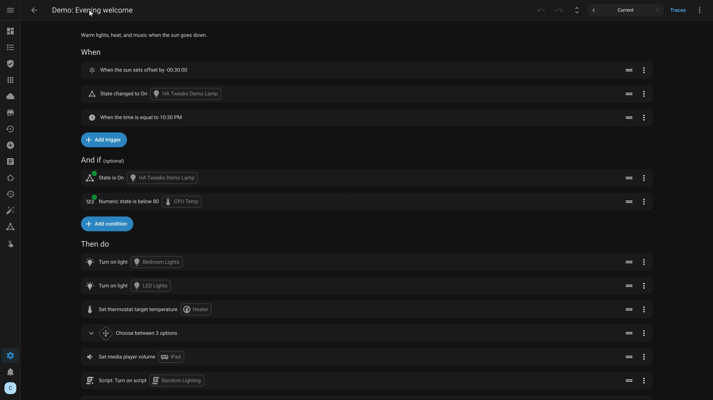
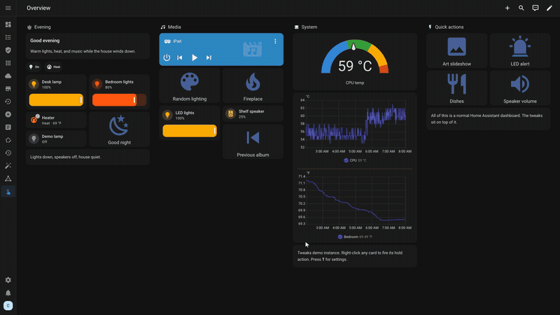
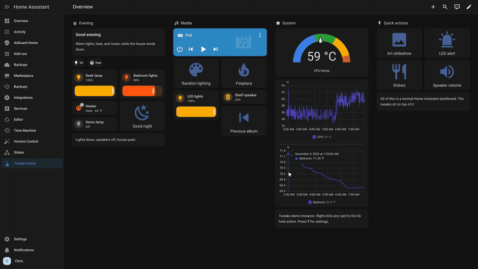
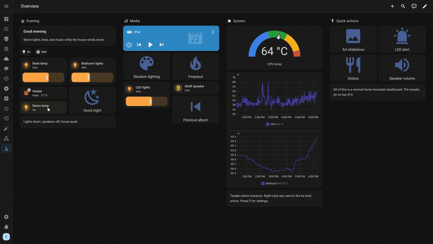
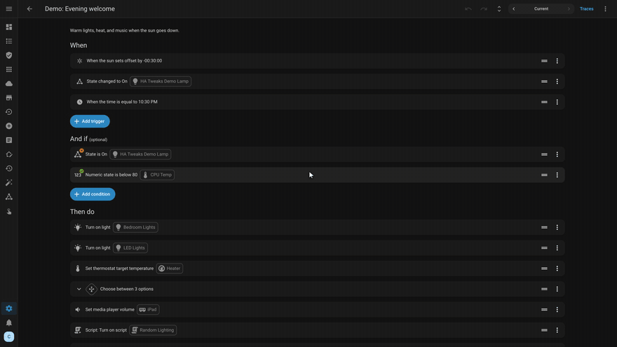

# Home Assistant Tweaks

[](https://my.home-assistant.io/redirect/hacs_repository/?owner=saihgupr&repository=HomeAssistantTweaks&category=plugin)
[](https://ko-fi.com/saihgupr)
[](LICENSE)

Small quality-of-life tweaks for the Home Assistant frontend. Each tweak changes one specific friction point: it adds a right-click menu where you expect one, keeps the automation editor tidy, removes the hold-action delay, or lets you drag sidebar items into place.

Press **`T`** anywhere in Home Assistant to open settings. Every toggle applies live instantly—no YAML edits, no page reload, and no server restart required.



*[Watch the full 75-second tour video](assets/ha-tweaks-tour-v1.18.19.mp4) · [Documentation & Wiki](https://github.com/saihgupr/HomeAssistantTweaks/wiki/Home)*

---

## Highlights

### Context menus anywhere you right-click
Right-click (or long-press in the Companion App) an automation or script to jump straight into Edit or Delete without digging through submenus. Right-click any trigger, condition, or action row inside the editor to copy, cut, or duplicate it. Right-click blank canvas on a dashboard to start a new card right where your cursor is.



### Calmer, folded automation editor
Automations open with all blocks collapsed instead of sprawling out over yards of screen. A toolbar button lets you **Collapse All** or **Expand All** with a single click, keeping even complex 50-action automations clean and readable.



### Inline title renaming
Click the title in the editor header to edit and rename it directly in place. Hit Enter or click outside to save. No opening overflow menus or metadata dialogs just to fix a typo.



### Instant card hold actions
Right-click any dashboard card, badge, or tile to trigger its hold action immediately. Skips the default 500 ms press-and-hold wait while keeping normal left-clicks untouched.



### Drag-to-reorder sidebar
Drag and drop sidebar items into whatever sequence you reach for most. The order saves directly into Home Assistant's native sidebar storage, syncing cleanly per user across desktop and mobile devices.



### Mushroom chips that wait (`for:`)
Configure chips with a `for:` duration so they stay hidden until an entity state has actually persisted for that length of time—no template math or temporary helper sensors required.



### Save history & restore in editors
Step back through previous saves directly inside the automation editor to inspect earlier revisions and restore working states.

> [!NOTE]
> Version history requires the companion [Home Assistant Version Control](https://github.com/saihgupr/HomeAssistantVersionControl) add-on to track revision snapshots.



### Optional Marketplace sidebar item
Adds a direct link to the Home Assistant Marketplace in the sidebar for admin users—no `panel_custom` configuration or restart needed. Can be reordered or hidden anytime.

---

## Installation

### Quick Start (HACS)

1. Click the HACS badge above, or in Home Assistant go to **Settings → Marketplace → Add from link** (or **HACS → Custom repositories**) with category **Plugin**, and enter:
   ```text
   https://github.com/saihgupr/HomeAssistantTweaks
   ```
2. Install **Home Assistant Tweaks**.
3. Add the loader to `configuration.yaml` (required so tweaks load on `/config` administration pages as well as dashboards):
   ```yaml
   frontend:
     extra_module_url:
       - /hacsfiles/HomeAssistantTweaks/ha-tweaks-loader.js
   ```
4. Restart Home Assistant once. Reload your browser page and press **`T`** to choose your tweaks.

<details>
<summary><b>Manual Installation</b></summary>

1. Download [`ha-tweaks.js`](ha-tweaks.js) and [`ha-tweaks-loader.js`](ha-tweaks-loader.js).
2. Place both files in your `<config>/www/` directory.
3. Add the loader reference to `configuration.yaml`:
   ```yaml
   frontend:
     extra_module_url:
       - /local/ha-tweaks-loader.js
   ```
4. Restart Home Assistant once and reload the page. Press **`T`** to open settings.

*Upgrading from v1.8.2 or earlier (formerly HA Mods): the script file was consolidated to `ha-tweaks.js`. Update your `extra_module_url` line to the loader path above; previously saved preferences transfer automatically.*

</details>

<details>
<summary><b>Updating & Verifying</b></summary>

### Updates
Update the plugin in HACS, then reload the page. The loader checks the asset ETag, so updates take effect immediately on reload without restarting Home Assistant.

### Verification
Open your browser developer console (`F12` or `Cmd+Option+I`) and look for:
```text
[HA Tweaks v1.18.19] Initialized
```
Typing `HATweaks.version` in the console returns the active version string.

</details>

---

## How It Works & Safety

- **Zero dependencies & zero external network calls:** One lightweight script with no external trackers, CDN requests, or telemetry.
- **Frontend-only presentation:** Changes happen entirely in your browser DOM. It never edits your backend YAML files, automations, entities, or storage registries directly.
- **Per-tweak fault isolation:** Each tweak runs inside its own isolated wrapper. If a future Home Assistant release updates a DOM selector, that specific tweak quietly steps aside and logs a debug message while every other tweak continues working normally.
- **100% opt-in:** Fresh installs start with all tweaks turned off. You opt in only to what you want. Turning all switches off returns Home Assistant to 100% stock behavior.
- **Cross-device profile sync:** Toggles are stored in Home Assistant user data with a fast local cache, so your preferences follow your login between desktop browsers and the Home Assistant Companion App.

---

## Disable or Remove

- **To temporarily disable:** Press **`T`** and turn off individual switches (or toggle all off to return to stock).
- **To uninstall:** Remove the plugin from HACS, remove the `extra_module_url` line from `configuration.yaml`, and restart Home Assistant once.

---

## FAQ

**Does this work in the Home Assistant Companion App?**  
Yes. Touch interactions are fully mapped: right-clicks become long-presses, and sidebar dragging supports touch-and-hold gestures. On devices without a physical keyboard, you can open the settings panel at any time by running `HATweaks.openSettings()` from a remote console or setting a custom card tap action.

**Does this cause frontend lag or drain battery?**  
No. Home Assistant Tweaks contains no continuous polling loops or interval timers. Menus and drag operations are purely event-driven, and editor folding executes once upon editor open.

**Why does an automation say "No UI ID"?**  
That automation was declared manually in YAML without an `id:` attribute. Home Assistant itself requires an `id:` to open an automation in the visual editor. Add an `id:` key to its YAML definition to enable editing.

---

## Contributing

1. Fork the repository.
2. Make your edits in `ha-tweaks.js`.
3. Verify syntax:
   ```bash
   node --check ha-tweaks.js
   ```
4. Open a Pull Request targeting `main`.

---

## Related Projects

- [Home Assistant Version Control](https://github.com/saihgupr/HomeAssistantVersionControl) — Automated snapshot history and restore engine for automations, scripts, and views (powers the version history tweak).
- [Home Assistant Time Machine](https://github.com/saihgupr/HomeAssistantTimeMachine) — Browse historical backups and restore individual files, views, and packages.

---

## Support & Feedback

- Star this project on [GitHub](https://github.com/saihgupr/HomeAssistantTweaks).
- File bugs or feature requests on [GitHub Issues](https://github.com/saihgupr/HomeAssistantTweaks/issues).
- If this project saves you daily clicks, consider supporting maintenance on [Ko-fi](https://ko-fi.com/saihgupr).

---

## License

This project is licensed under the [MIT License](LICENSE).
